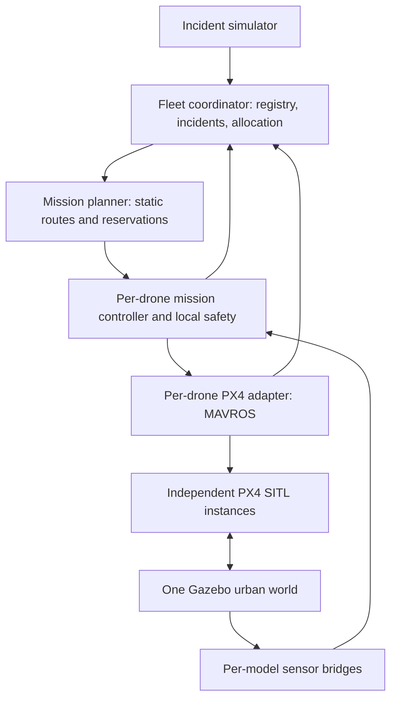

# PALS drone swarm implementation plan

Prepared 4 November 2026 from the local source and both supplied project briefs.

Implementation progress: the first increment adds `scripts/swarm.py`, `config/fleet.json`,
portable legacy paths, environment inventory, and `pals_drone_controller`. See
`SWARM_GUIDE.md` for operation. Dependency-free checks pass; M0/M1/M2 flight acceptance
remains open until Ubuntu SITL validation. Central coordination and later milestones
remain unimplemented. The repository assessment below records the pre-implementation baseline.

## Intended result

One reproducible Ubuntu launch starts an urban Gazebo world, three independent PX4 vehicles, three isolated ROS 2 adapters/controllers, and a central fleet coordinator. Two vehicles patrol and one waits at its base. Simulated incidents interrupt patrols, cause battery-aware assignments, and exercise incident leader/worker roles. Every vehicle can return and land without keyboard piloting.

First delivery gate: three independently controlled vehicles with autonomous waypoint flight and central registration. Complete the incident scenario only after this gate passes. Scale to five afterward.

## What the repository actually contains

| Source | Current behavior | Implication |
|---|---|---|
| `launch_sim.sh` | Starts PX4 instance 0 in the `urban` world and an unconditional GUI follow loop | Extend launch orchestration; separate optional visualization from flight |
| `launch_bridge.sh` | One MAVROS connection and globally named sensor bridges | Parameterize identity and endpoints; isolate Gazebo sources as well as ROS destinations |
| `generate_city.py` | Seeded roads/buildings/trees; writes to `/home/salman/drone_sim/...` | Retain existing city; make output path configurable and export obstacle geometry |
| `px4/Tools/simulation/gz/worlds/urban.sdf` | Existing generated urban world | No need to find or model a new city for the first demo |
| `px4/Tools/simulation/gz/models/x500/model.sdf` | Modified x500 with RGB-D camera and GPU lidar; explicit `/camera` and `/lidar` topics | Multiple model instances would share sensor topics unless fixed at the Gazebo source |
| `drone_ml/teleop_keyboard.py` | Manual velocity control at 20 Hz, absolute `/mavros/...` names | Keep as an optional development tool; one command owner per drone |
| `drone_ml/drone_rl_node.py` | Placeholder with constant upward velocity, manual arming | No RL policy or autonomous mission control; +0.2 m/s is ascent, not position hold |
| `drone_ml/follow_cam.py`, `stream_video.py` | Hardcoded vehicle/camera/video settings | Optional presentation components, parameterize later |
| `drone_ml/package.xml` | Missing runtime dependency declarations | Add dependencies when packaging the new nodes |
| `README.md`, `INSTRUCTIONS.md` | Duplicated single-drone operating instructions with `~/drone_sim` paths | Document verified multi-drone operation and remove machine-specific assumptions |

No fleet coordinator, incident manager, mission planner, battery allocator, autonomous landing workflow, or project-specific tests were found in the inspected application source. The decentralized research stack described in the first attachment is not installed here. Its benchmark numbers are reference claims, not PALS results.

The current inspection host is Darwin/macOS; `/opt/ros` is absent and `ros2`/`gz` were not found on PATH. Live flight and the Ubuntu package inventory remain unverified. The README reports Humble, Harmonic, and PX4 v1.14.x, but the vendored PX4 has no nested Git metadata establishing that exact revision.

## Architecture decisions

1. Use central fleet authority, with independent local flight controllers. This matches PALS. Incident leaders coordinate observation roles within their assignment; they do not arm peers or bypass the central allocator.
2. Keep MAVROS for the initial delivery, since all existing control code uses it. Put it behind `pals_px4_adapter` so a later direct DDS adapter does not change mission logic. Do not add a second active command transport. A DDS migration would require firmware-compatible `px4_msgs` and explicit frame/QoS validation.
3. Target Ubuntu 22.04 + ROS 2 Humble. Audit the existing Gazebo installation before selecting the matching PX4/`ros_gz` combination. Prefer validating the repository's Harmonic configuration in an isolated environment over replacing an existing Fortress setup. Pin the successful combination, build inputs, patches, and assets.
4. Use simulated GPS/local-position flight and known static world geometry initially. Keep VIO, ESDF mapping, CBBA, pursuit, GPU mapping, and learned control out of the first delivery. Borrow the research platform's pure algorithm core/thin ROS wrapper pattern. AMD hardware should not acquire an NVIDIA-specific mapping dependency.
5. Include static obstacle clearance and fleet separation before simultaneous autonomous flights. Initial reserved routes and altitude lanes are an explicit restricted operating model; they are not general dynamic collision avoidance.

## Packages and contracts

| Package | Responsibility |
|---|---|
| `pals_interfaces` | Messages, actions, service definitions; use `ament_cmake`/ROSIDL |
| `pals_px4_adapter` | Namespaced MAVROS IO, telemetry normalization, acknowledged mode/arm/land calls, continuous setpoints |
| `pals_drone_controller` | Per-vehicle mission state machine, waypoint tracking, watchdogs and return/landing |
| `pals_fleet_coordinator` | Registration, incident lifecycle, eligibility, assignment, role membership and reassignment |
| `pals_mission_planner` | Patrol sectors, route graph/A*, travel/energy estimates and return routes |
| `pals_collision_avoidance` | Route reservations, separation checks and trajectory constraints |
| `pals_incident_simulator` | Seeded incident events and explicit fault injection |
| `pals_bringup` | Launch files, fleet/world/route/scenario YAML, diagnostics and recording |

Implement pure Python mission, routing and allocation logic separately from ROS callbacks. Build packages when their milestone needs them; avoid empty scaffolding for every future feature.

Proposed interfaces:

- `DroneTelemetry`: drone ID, stamped pose in a declared frame, velocity, connection/armed/mode, landed/health state, battery value and validity/source, mission ID/revision, availability, heartbeat sequence.
- `IncidentReport`: event ID, location/frame, severity, timestamp, source, verification state. The coordinator owns canonical incident IDs and merges nearby compatible reports within configurable distance/time windows.
- `ExecuteMission` action: mission ID/revision, incident ID, role, route, deadline, return policy; feedback includes progress/state; result gives completion/failure reason. Cancellation must acknowledge a controlled hold or replacement, not instantly stop setpoints.
- `FleetAssignment`/`MissionStatus`: assignment revision, vehicle, incident, leader/worker role, lease, progress and failure reason. Reject stale revisions and replayed terminal commands.
- Registration service plus heartbeat: reject duplicate identities; recover node restarts without issuing duplicate missions. Support a simple event log/snapshot for coordinator recovery.

Use `/pals/fleet/...` and `/pals/incidents/...` for shared topics and `/pals/drone_1/...` for vehicle-specific APIs. Use relative names inside nodes. Set telemetry QoS to match publishers; use reliable mission commands and durable current assignment snapshots where appropriate. Parameterize timing and freshness limits.

## Identity, coordinates and timing

Generate one authoritative fleet manifest:

| ID | PX4 instance | MAVLink system ID | Gazebo model | MAVROS bind port | PX4 offboard local port |
|---|---:|---:|---|---:|---:|
| drone_1 | 0 | 1 | x500_0 | 14540 | 14580 |
| drone_2 | 1 | 2 | x500_1 | 14541 | 14581 |
| drone_3 | 2 | 3 | x500_2 | 14542 | 14582 |

These port formulas and system IDs come from the checked-in `px4-rc.mavlink` and `rcS`; verify the live binary uses those startup files. The existing bridge uses `14557` as its remote endpoint, so inspect live MAVLink status/handshake before replacing it. Generate each final `fcu_url` from the verified manifest.

Run one Gazebo world with separate PX4 instance working directories/logs/parameters. Use the checked-in `PX4_GZ_MODEL`/`PX4_GZ_MODEL_POSE` or model-binding support after confirming behavior against the pinned build. Wait for world readiness before spawning; verify each bridge is talking to its intended vehicle. Clean up only processes owned by this launch.

Define shared ENU `map`, per-drone local ENU frames, and unique body frames. Explicitly determine transforms between each PX4 local origin and the shared map, including yaw; spawn offsets alone must not be assumed to establish those transforms. MAVROS plugins generally handle ROS/PX4 frame conversion: verify the selected plugins and avoid double conversion. Test known east/north/up displacements, yaw, and returns from nonzero spawn locations.

Bridge `/clock`; use simulation time for mission progress and a steady clock for process/connection watchdogs. A paused world must not advance mission deadlines or cause uncontrolled command replay on resume.

## Ordered implementation milestones

### M0 — Reproduce and pin the single-drone baseline

Inventory Ubuntu ROS/Gazebo/MAVROS/`ros_gz` versions, PX4 build provenance, graphics capability, assets and existing projects. Record the package combination rather than relying on the README's version label. Check missing submodules/build dependencies in the vendored source. Make scripts resolve paths from their own location, add dependency checks and bounded readiness waits, and make city generation accept seed/output options. Preserve existing projects and custom sensor changes.

Acceptance: clean build and single-drone telemetry on Ubuntu; manual baseline still works; logs and version manifest explain how to reproduce it. No autonomous flight claim yet.

### M1 — Three independent simulated vehicles

Add `pals_bringup` fleet manifest and multi-instance launcher. Start one world and three separated launch pads. Generate model-specific camera/lidar topics and frame IDs before bridging; ROS remapping alone cannot separate already mixed Gazebo topics. Initially disable unnecessary video/lidar workloads; enable sensors incrementally. Bridge a single clock. Provide optional GUI follow targeting.

Acceptance: all three models/heartbeats/poses are distinct; commanding a single vehicle affects only it; sensor source isolation is demonstrated; repeated start/stop leaves no owned processes or occupied ports. Record real-time factor and resource usage on the target machine.

### M2 — Autonomous flight and local safety

Implement adapter and controller with states `DISCONNECTED → READY → PRESTREAM → ARMING → TAKEOFF → HOLD → EXECUTE → RETURN → LANDING → LANDED`, plus `RECOVERY`/`FAULT`. READY requires fresh connected telemetry, valid position/home, healthy battery and allowed flight conditions. Stream safe position setpoints at 20 Hz before Offboard entry; use asynchronous service calls, retry limits and confirmed state transitions. Continue streaming independently of planning and allocation. A timer must never block on a service.

Implement bounded-speed waypoint following, arrival radius plus dwell, altitude limits, mission timeout, safe return and confirmed landed/disarmed completion. Use position hold rather than zero-velocity assumptions. Configure and verify PX4 Offboard-loss behavior; flight-side fallback must still work if ROS dies. Unknown/stale telemetry prevents new launches. Do not blindly fly home when localization is invalid.

Acceptance: one drone autonomously takes off, flies a rectangle, holds, returns and lands; repeat with three reserved routes. Inject mode rejection, lost telemetry and controller termination; verify bounded recovery and configured PX4 fallback. No manual arm.sh step.

### M3 — Registry, patrol and battery-aware allocation

Add coordinator, interfaces and planner cores. Define dock positions, patrol sectors, static route graph, speed limits and return corridors. Export building/tree bounds from the generator or derive a checked map from the SDF; inflate obstacles for vehicle size and clearance. Validate route segments including climb/descent, not just waypoints. Reserve intersections/altitude transitions and base approach slots; enforce a configurable minimum separation.

Use PX4 battery telemetry only when validated as meaningful; otherwise use a labeled deterministic simulation energy model. Estimate mission plus return energy with a configurable reserve. Filter disconnected, stale, unhealthy, infeasible and committed vehicles before scoring travel time, remaining energy and interruption cost. Tie-break deterministically by drone ID. Unknown battery is ineligible; low battery forces a safe return independent of coordinator availability.

Acceptance: two drones patrol, third remains standby; registration and mission progress are visible; infeasible allocations are rejected; low-battery patrol replacement works. Unit tests cover transforms, route clearance, eligibility, energy reserve and deterministic decisions.

### M4 — Incidents, roles and reassignment

Add reproducible event scenarios and incident lifecycle `REPORTED → VERIFIED → ASSIGNED → ACTIVE → RESOLVED`, with explicit blocked/cancelled paths. Verification initially comes from scenario events, not a claimed vision model. Deduplicate reports without merging distinct nearby incidents indiscriminately.

Assign a reconnaissance leader and optional traffic-observer worker at distinct observation positions. Roles belong to an incident and assignment revision. A leader provides observation/task status; the central coordinator owns reassignment. Keep the current leader until a replacement acknowledges handover or it becomes unavailable. Add assignment leases, cancellation acknowledgements, hysteresis and maximum replanning rate. If all eligible drones are busy, queue the incident with a reason; never silently overwrite an active action.

Acceptance: execute the supplied two-incident sequence, dispatch by eligibility/priority, replace a leader or worker after injected failure, prevent duplicate ownership, and return all remaining vehicles. Record dispatch latency, response travel time, completion, rejected assignments, minimum separation and reason-coded failures.

### M5 — Harden, demonstrate and expose integration APIs

Add a single documented launch entry point, scenario runner, rosbag/event recording, diagnostics, per-instance logs, and a replayable result summary. Run ten consecutive seeded demo executions with no manual piloting, cross-vehicle commands, collisions, or unresolved mission ownership. Set explicit waypoint/separation tolerances in scenario configuration and report actual outcomes. Repeat with five drones only after the three-drone gate passes; reduce sensor rates if simulation falls behind.

Expose normalized telemetry/incidents and mission status for later FastAPI integration. Backend outage must not stop local flight safety. Dashboard, SUMO, hospital/ambulance allocation, camera accident detection, GPS-denied navigation, decentralized allocation and large-fleet headless benchmarks are subsequent projects.

## Verification and delivery boundaries

Run dependency-light tests for allocator decisions, mission transitions, deduplication, assignment revisions/leases, coordinate transforms, route collision checks and energy feasibility. Use ROS integration tests for namespacing, action cancellation, endpoint isolation and stale-data behavior. Use Ubuntu SITL scenarios for all flight claims, including coordinator restart, connection loss, low battery and interrupted Offboard streaming. Report measured timing alongside simulation real-time factor.

No simulation was launched during this planning task. This document changes no flight code or environment settings. The next executable task is M0, followed by M1; Ubuntu flight evidence is required to close those gates.

## Reference material

- [PX4 multi-vehicle Gazebo guidance](https://docs.px4.io/main/en/sim_gazebo_gz/multi_vehicle_simulation): supported instance/model mechanisms. Current main documentation is guidance; the pinned local release determines exact launch behavior.
- [PX4 Offboard requirements](https://docs.px4.io/main/en/flight_modes/offboard): continuous proof-of-life above 2 Hz and an initial stream before Offboard entry; use 20 Hz with margin and validate configured loss behavior.
- [Original simulation reference](https://github.com/imFARSI/px4-ros2-gazebo-autonomous-drone-sim): environment and sensor/visualization reference; local source remains authoritative for this plan.
- [Swarm Autonomy research reference](https://github.com/Manas-arumalla/swarm-autonomy): architecture inspiration for isolated algorithm cores and measured communication behavior. Audit implementation, licenses and dependencies before copying code; do not import its benchmark claims into PALS.
